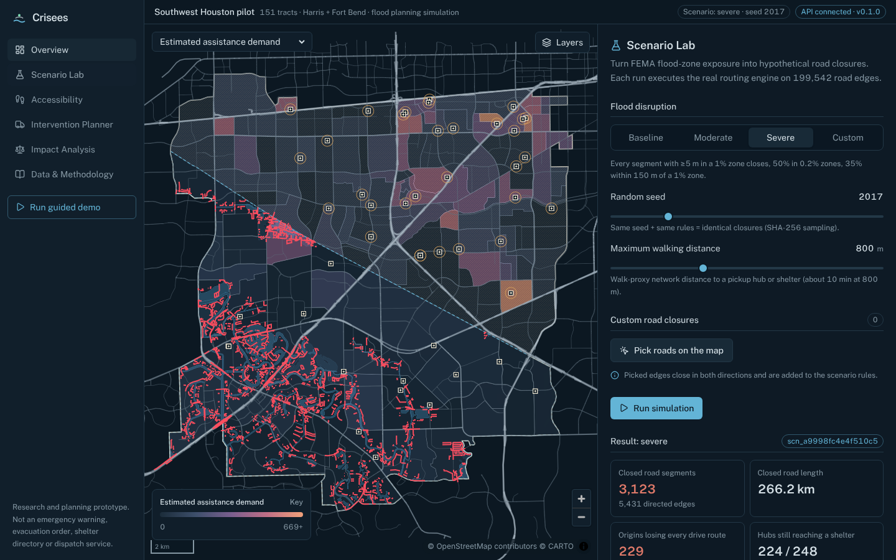

# Crisees

**Find the gaps. Plan the response.**

Crisees is an equity-aware evacuation planning platform. It uses public demographic and geographic data,
network analysis and mathematical optimization to help planners see where communities might struggle to
reach evacuation assistance during a flood. It simulates hypothetical flood-related road disruptions and
tests how limited pickup hubs, vehicles and shelter space could be allocated.

> Crisees is a research and planning prototype. It is not an emergency warning, evacuation order, verified
> shelter directory, or dispatch service.



## The problem

In a flood, households without a car depend on someone else to get out. When roads close, the places
they could walk to for a ride may be cut off from shelters. Emergency planners have to decide, with
limited buses and staff, where to stage temporary pickup points. Crisees makes that trade-off visible and
testable with public data, rather than leaving it to intuition.

**Who it is for:** emergency-management planners, transportation agencies and community organizations who
plan for evacuation of transit-dependent residents. It is built for planning and exercises, not live
operations.

## What it does

| Feature | What you can do |
| --- | --- |
| **Interactive map** (MapLibre) | Census tracts colored by need, access or plan coverage; FEMA flood zones; hatched "no FEMA data" area; simulated closures; candidate and selected hubs; assumed shelters; conceptual hub→shelter allocation lines |
| **Scenario Lab** | Baseline, moderate or severe presets, or custom closure rules and a seed. Click roads on the map to close them. Each run executes the real routing engine on 199,542 road edges |
| **Accessibility** | Walk access to hubs, drive routes to shelters, disconnected tracts and access lost, per tract and region-wide |
| **Intervention Planner** | Set vehicles, seats, hub budget, shelter capacity, horizon, walking distance and equity or equal weighting, then select **Optimize response**. A MILP (HiGHS) chooses hubs and vehicle trips; solver status, gap, binding constraints and an independent constraint check are shown |
| **Impact Analysis** | Five counterfactual cases with identical inputs: baseline; flood without intervention; flood with the equity plan; flood with the equal-weight plan; baseline hubs reused in the flood |
| **Guided demo** | An eight-step, three-minute walkthrough that calls the real backend at every step |
| **Data & Methodology** | Sources, live dataset status, model formulation, equity weights and limitations |

### What is real and what is hypothetical

| Real public data | Model estimates | Hypothetical |
| --- | --- | --- |
| Census tracts, population, car-free households, poverty, disability (ACS 2020–2024, TIGER 2024); CDC SVI 2020; road network (OpenStreetMap via Overture); mapped facilities; FEMA flood zones for the Fort Bend portion (about 52% of the area) | Assistance demand, travel times, walking access, selected hubs and trips | Flood road closures, participation rate (50%), vehicles, hub and shelter capacities, which facilities act as shelters |

### Demonstration results (modelled, severe scenario, seed 2017)

These are fetched live by the app, never hard-coded.

| | Value |
| --- | ---: |
| Estimated persons needing assistance | 23,033 |
| Flood, no intervention: assisted | 5,214 (22.6%) |
| Flood + 12 optimized hubs, 15 vehicles: assisted | 9,493 (41.2%) |
| Change | +4,279 (+18.6 percentage points) |
| Equity vs equal weighting | Same total; coverage redistributed toward higher-priority tracts |

## Stack and architecture

```
frontend/  Next.js 15 (App Router) · TypeScript · Tailwind v4 · MapLibre GL · Recharts · Lucide · zod
           └─ typed API client (timeouts, cancellation, stale-response protection, runtime validation)
backend/   FastAPI · Pydantic · GeoPandas · Shapely · SciPy (Dijkstra + HiGHS MILP) · NetworkX · OSMnx
           ├─ app/        API, schemas, services, analysis engine (app/engine)
           └─ pipeline/   reproducible data download, processing and validation
scripts/   download / process / validate data · package and fetch data releases · Phase 2 benchmark
docs/      architecture, data sources, data dictionary, API, methods, results, submission and deployment
```

See [docs/ARCHITECTURE.md](docs/ARCHITECTURE.md).

## Run it locally

Requirements: Python 3.11+ and Node 20+.

```bash
cd backend && python -m venv .venv && source .venv/bin/activate && pip install -e ".[dev]"   # includes pipeline + server extras
```

Then get the data. Either install the published data release (fast, checksum verified):

```bash
CRISEES_DATA_URL=<release asset URL> CRISEES_DATA_SHA256=<sha256> python scripts/fetch_data_release.py
```

Or rebuild it from public sources (about 5 minutes):

```bash
python scripts/download_data.py && python scripts/process_data.py && python scripts/validate_data.py
```

Start the API:

```bash
cd backend && uvicorn app.main:app --port 8000
```

Start the frontend:

```bash
cd frontend && npm install && cp .env.example .env.local && npm run dev
```

Open http://localhost:3000 and select **Run guided demo**.

## Testing

```bash
cd backend && python -m pytest                 # 157 tests: algorithms, API contracts, real-data end to end
cd frontend && npm run typecheck && npm run lint && npm test && npm run build
cd frontend && npm run e2e                     # Playwright browser test against running servers
python scripts/benchmark_phase2.py             # performance + demonstration numbers
```

The browser test checks that the numbers the UI displays match direct API responses.

## Deployment

The backend runs as a Docker service (Render blueprint in `render.yaml`, about 1 GB RAM). Data is
provisioned at startup from a versioned, SHA-256-verified release artifact, so no datasets are stored in
Git. The frontend deploys to Vercel with `NEXT_PUBLIC_API_BASE_URL` set. See
[docs/DEPLOYMENT.md](docs/DEPLOYMENT.md).

## Data provenance

Every dataset records its source, retrieval time, provider and checksum (`data/processed/*/manifest.json`
and `.source.json` sidecars). Several primary sources were unreachable from the build environment, so
documented mirrors and fallbacks were used. See [docs/DATA_SOURCES.md](docs/DATA_SOURCES.md).

## Limitations

- FEMA flood data covers about 52% of the study area (Fort Bend). Harris County disruption is a lower bound,
  and uncovered areas are shown as **unknown**, not safe.
- Flood closures, participation, fleet and capacities are hypothetical planning assumptions.
- Mapped facilities are not verified shelters. Schools and private properties need owner authorization.
- Walking access uses the road network as a proxy for sidewalks. Travel times are mostly road-class
  free-flow estimates (only 6% of edges have posted speeds).
- The vehicle model is a fleet-time capacity approximation, not vehicle routing or scheduling.
- Results are modelled outcomes, not demonstrated real-world impact.

## Documentation

[Architecture](docs/ARCHITECTURE.md) · [Data sources](docs/DATA_SOURCES.md) ·
[Data dictionary](docs/DATA_DICTIONARY.md) · [API](docs/API.md) ·
[Optimization model](docs/OPTIMIZATION_MODEL.md) · [Scenario engine](docs/SCENARIO_ENGINE.md) ·
[Accessibility methods](docs/ACCESSIBILITY_METHODS.md) · [Phase 2 results](docs/PHASE2_RESULTS.md) ·
[Deployment](docs/DEPLOYMENT.md) · [Demo script](docs/DEMO_SCRIPT.md) ·
[Devpost submission](docs/DEVPOST_SUBMISSION.md) · [Release checklist](docs/RELEASE_CHECKLIST.md)

## Attribution

Contains U.S. Census Bureau TIGER/Line and ACS data, CDC/ATSDR SVI data and FEMA flood hazard data.
It also contains OpenStreetMap data (© OpenStreetMap contributors, ODbL 1.0) and Overture Maps data
(CDLA-Permissive-2.0). Basemap tiles © CARTO.
