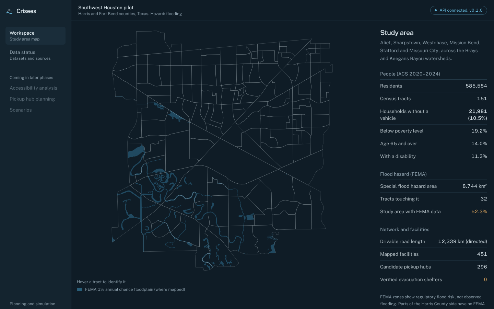

# Crisees

Equity-aware flood evacuation accessibility and intervention planning for Houston / Harris County, Texas.

Crisees helps emergency planners and community organizations see where residents without a car, or with
other barriers, would struggle to reach evacuation resources during a flood, and where temporary pickup hubs
and limited transport could do the most good. It is a **planning and simulation platform**, not an
emergency dispatch system.



## Status: Phase 1 (foundation and data infrastructure)

| Phase | Scope | State |
| --- | --- | --- |
| 1 | Monorepo, FastAPI backend, real-data pipeline, data model, API, Next.js shell | **Done** |
| 2 | Accessibility metrics, flood-disruption scenarios, hub optimisation | Not started |
| 3 | Planner-facing dashboard and map UI | Not started |

Pilot region: **`houston-sw-pilot`**, 151 census tracts (110 in Harris County, 41 in Fort Bend County),
about 287 km² and 586,000 residents across Alief, Sharpstown, Westchase, Mission Bend, Stafford and
Missouri City. See [docs/DATA_SOURCES.md](docs/DATA_SOURCES.md#geographic-scope) for why this area was chosen.

## Repository layout

```
backend/            FastAPI app (app/) and data pipeline (pipeline/), Pytest suite (tests/)
  app/regions/definitions/   one JSON file per study region
frontend/           Next.js (App Router, TypeScript, Tailwind) application shell
scripts/            download_data.py, process_data.py, validate_data.py
data/raw/           downloaded source files + .source.json provenance sidecars (git-ignored)
data/processed/     standardized GeoParquet/Parquet + manifest.json (git-ignored)
docs/               architecture, data sources, data dictionary, API reference
```

## Quick start

Requirements: Python 3.11+, Node.js 20+ (tested with Python 3.13 and Node 22).

### 1. Backend

```bash
cd backend
python -m venv .venv && source .venv/bin/activate
pip install -e ".[dev]"
cp .env.example .env    # optional; defaults work for local development
```

### 2. Data (about 70 MB of downloads, 3 to 5 minutes)

From the repository root:

```bash
python scripts/download_data.py --region houston-sw-pilot
python scripts/process_data.py --region houston-sw-pilot
python scripts/validate_data.py --region houston-sw-pilot
```

Downloads are cached: rerunning skips anything already on disk with a provenance sidecar.
Add `--force` to refresh, or `--only roads facilities` to fetch a subset. Each source has an ordered list of
providers and falls back automatically (for example OSMnx/Overpass, then Overture Maps for roads). The
provider actually used is recorded in `data/processed/<region>/manifest.json`.

### 3. Run the API

```bash
cd backend
uvicorn app.main:app --reload --port 8000
```

Open http://localhost:8000/docs for interactive OpenAPI docs. Health check: http://localhost:8000/health.

### 4. Run the frontend

```bash
cd frontend
npm install
cp .env.example .env.local   # optional; points at http://localhost:8000 by default
npm run dev
```

Open http://localhost:3000. The status pill in the top bar shows whether the API is reachable, and
**Data status** lists every dataset with its source and caveats.

## Tests and checks

```bash
cd backend && python -m pytest          # 97 tests; real-data checks skip if data not generated
cd frontend && npm run typecheck && npm run lint && npm run build
```

The backend tests run without network access. They use a clearly labeled synthetic fixture
(`backend/tests/fixtures/synthetic.py`) that the pipeline marks with `provenance: "synthetic"`.

## Environment variables

| Variable | Default | Purpose |
| --- | --- | --- |
| `CRISEES_DATA_DIR` | `../data` (relative to `backend/`) | Root holding `raw/` and `processed/` |
| `CRISEES_CORS_ORIGINS` | `http://localhost:3000,http://127.0.0.1:3000` | Allowed browser origins |
| `CRISEES_LOG_LEVEL` | `INFO` | Python log level |
| `CRISEES_DEFAULT_PAGE_SIZE` / `CRISEES_MAX_PAGE_SIZE` | `500` / `5000` | API pagination bounds |
| `CENSUS_API_KEY` | unset | Optional. Uses the Census Data API instead of the ACS Summary File |
| `NEXT_PUBLIC_API_BASE_URL` | `http://localhost:8000` | Frontend → backend URL |
| `NEXT_PUBLIC_DEFAULT_REGION` | `houston-sw-pilot` | Region shown by the frontend |

No secrets are required. Never commit `.env` files.

## Documentation

- [docs/ARCHITECTURE.md](docs/ARCHITECTURE.md): system design, conventions, how Phase 2 plugs in
- [docs/DATA_SOURCES.md](docs/DATA_SOURCES.md): every source, license, retrieval method, fallback and limitation
- [docs/DATA_DICTIONARY.md](docs/DATA_DICTIONARY.md): every processed dataset and field
- [docs/API.md](docs/API.md): endpoint reference with examples

## Known limitations (summary)

- FEMA flood zones currently cover only the Fort Bend part of the pilot (52% of the area). The official
  FEMA NFHL service is wired in as the primary source but was unreachable from the build environment.
- Roads and facilities came from Overture Maps (OpenStreetMap-derived) because the Overpass API was
  unreachable. On a normal network, the pipeline uses OSMnx first.
- SVI is the 2020 edition (ACS 2016–2020), via an ArcGIS Online copy. ACS indicators are 2020–2024.
- No facility is a verified evacuation shelter. Open data cannot establish that.

Full details are in [docs/DATA_SOURCES.md](docs/DATA_SOURCES.md#known-limitations).

## Attribution

Contains information from OpenStreetMap contributors (ODbL 1.0) via Overture Maps Foundation, Overture
Maps places data (CDLA-Permissive-2.0), U.S. Census Bureau TIGER/Line and American Community Survey data,
CDC/ATSDR Social Vulnerability Index data, and FEMA flood hazard data.
